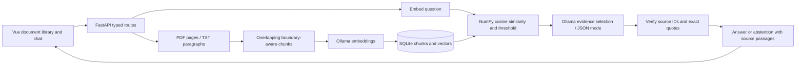

# Local AI Knowledge Assistant

A local-first document question-answering application built with Python, FastAPI,
Ollama, SQLite/NumPy vector search, and Vue 3 + TypeScript. Upload PDF or TXT files,
ask a question, and inspect the original passages behind each answer.

This is an independent learning and portfolio project. It is not affiliated with,
derived from, or intended to represent any employer's products or code. All sample
documents are synthetic. No paid API or API key is required.

## First Milestone

The working flow is upload -> extract -> chunk -> embed -> persist -> retrieve ->
select evidence -> validate quotes -> answer with citations. It includes a document
library, deletion, ingestion status, session chat history, model health, structured
request logs, unit/API tests, an opt-in real-model test, Docker Compose, and CI.

**Deliberately conservative answers:** Ollama selects relevant verbatim quotes rather
than writing unchecked paraphrases. The backend verifies every quote occurs in its
cited retrieved passage and constructs the citation metadata itself. Invalid JSON,
unknown sources, invented quotes, or no evidence produce an explicit abstention.
This does not prove that a retrieved quote is relevant or that a document is true;
review the displayed sources. Semantic relevance is still a model judgment.

## Architecture



```text
backend/
	app/
		main.py         Application lifespan, error handling, JSON request logs
		routes.py       Health, upload, list, delete, and question endpoints
		models.py       Typed API contracts
		config.py       Environment configuration
		limits.py       Bounded request bodies before multipart parsing
		extraction.py   pypdf pages and UTF-8 TXT paragraphs
		chunking.py     Word-boundary-aware chunks with character overlap
		ingestion.py    Extract/embed/atomic index transaction
		embeddings.py   Batched Ollama embedding adapter
		store.py        Persistent SQLite vector store
		retrieval.py    Exact cosine search over local vectors
		generation.py   Ollama generation and citation/quote validation
		errors.py       Expected application errors
	tests/            Deterministic unit/API tests and opt-in Ollama test
frontend/src/       Vue UI, typed HTTP client, responsive styles
samples/            Synthetic demonstration documents
.github/workflows/  Python checks and frontend build
```

SQLite stores document metadata, extracted passages, and embedding vectors together.
NumPy performs exact cosine ranking in process: simple and inspectable for a small
personal corpus, not an approximate nearest-neighbor service. Each connection is
closed after its transaction. Documents and chunks commit together only after all
embeddings succeed. Deletion cascades to indexed chunks. Original upload files are
not retained. PDF page numbers are 1-based; TXT section numbers refer to blank-line
separated paragraphs. Chunks do not cross page/section boundaries.

## Native Setup (Recommended on macOS)

Prerequisites: **Python 3.12+**, Node.js 20+ (22 LTS recommended), npm, and a recent
[Ollama](https://ollama.com/download). Model downloads need internet and several GB
of disk/RAM; inference stays local. Apple Silicon acceleration works best with native
Ollama rather than a Linux container. Close other large models if memory is tight.

Run all commands from the repository root. Start the Ollama application, or run
`ollama serve` in its own terminal if it is not already running. Then:

```sh
ollama pull nomic-embed-text
ollama pull qwen2.5:3b
cp .env.example .env
python3.12 -m venv .venv
source .venv/bin/activate
python -m pip install -e './backend[dev]'
npm --prefix frontend ci
```

Python 3.13 also works: substitute `python3.13` above. Do not rely on macOS's system
`python3`, which may be older than 3.12. To use an already installed chat model,
set `CHAT_MODEL` in `.env` to its exact name from `ollama list`.

Terminal 1, from the repository root with the virtual environment activated:

```sh
uvicorn app.main:app --host 127.0.0.1 --port 8000 --reload --no-access-log
```

Terminal 2:

```sh
npm --prefix frontend run dev
```

Open **http://127.0.0.1:5173**. Vite prints another port if 5173 is occupied.
The UI proxies `/api` to port 8000; no permissive CORS configuration is needed.
For a different backend port, set `API_PROXY_TARGET` when starting Vite.
Interactive API documentation: **http://127.0.0.1:8000/docs**.

## Try the Flow

1. Add `samples/helios-mission.txt`; wait for its Ready status.
2. Ask: `What is the Helios observatory launch code?`
3. Expect a quote containing `ORBIT-42`, with a filename and text-section citation.
4. Open the source button to inspect the full retrieved passage.
5. Ask: `What is the exact population of Tokyo in the year 1920?`
	 Expect the insufficient-evidence message, not an answer from general knowledge.
6. Add a text-based PDF to see page citations. Scanned PDFs need OCR and are rejected
	 if no readable text can be extracted.
7. Delete a document to remove its metadata and indexed chunks. The UI also clears
	 its conversation so deleted-source excerpts do not remain visible there.

API example:

```sh
curl -F 'file=@samples/helios-mission.txt' http://127.0.0.1:8000/api/documents
curl http://127.0.0.1:8000/api/documents
curl http://127.0.0.1:8000/api/health
curl http://127.0.0.1:8000/api/chat \
	-H 'Content-Type: application/json' \
	-d '{"question":"What is the Helios observatory launch code?"}'
curl -X DELETE http://127.0.0.1:8000/api/documents/DOCUMENT_ID
```

## Configuration

See `.env.example`. Settings are loaded from `.env` in the **current working
directory**; process environment variables override it. No secrets are needed.

| Setting | Default | Purpose |
| --- | --- | --- |
| `DATA_DIR` | `./data` | Local SQLite index; ignored by Git |
| `OLLAMA_URL` | `http://127.0.0.1:11434` | Trusted Ollama server |
| `EMBEDDING_MODEL` | `nomic-embed-text` | Document and question embedding model |
| `CHAT_MODEL` | `qwen2.5:3b` | Evidence-selecting language model |
| `OLLAMA_TIMEOUT` | `120` | Per-model-request timeout in seconds |
| `MAX_UPLOAD_MB` | `10` | Per-file limit in MiB (1-100) |
| `MAX_DOCUMENT_CHARS` | `500000` | Extracted text ceiling |
| `CHUNK_SIZE` / `CHUNK_OVERLAP` | `1200` / `200` | Character-based chunk settings |
| `TOP_K` | `5` | Maximum retrieved passages |
| `MIN_SIMILARITY` | `0.45` | Cosine cutoff, not a confidence probability |

Changing the embedding model requires a **new `DATA_DIR` and re-uploading files**;
mixing model vector spaces is prevented at startup. Changing chunk settings affects
new uploads only. Re-upload old documents if you want consistent chunking. Smaller
models or different corpora may require tuning the retrieval cutoff; higher cutoffs
trade recall for more abstentions. Model generation uses temperature zero, but output
can still vary across model versions and hardware.

`GET /api/health` returns HTTP 200 for a live API and reports `ok` or `degraded`,
database availability, Ollama availability, missing models, and configured model names.
Model presence is not a guarantee of inference readiness or sufficient RAM. JSON
application logs include request ID, method, path, status, and duration, never question
text or document bodies. Responses include `X-Request-ID`.

## Tests and Checks

```sh
source .venv/bin/activate
pytest backend/tests -q
ruff check backend
ruff format --check backend
npm --prefix frontend run build
npm --prefix frontend audit
```

Normal tests use deterministic adapter doubles or mocked HTTP, not paid services or
model downloads. They cover overlap, empty/invalid/oversized files, real PDF parsing,
page/section citations, retrieval filtering, atomic failed ingestion, persistence,
deletion, upstream failures, prompt boundaries, and fail-closed answer validation.

With Ollama running and both configured models pulled, run the real integration test:

```sh
RUN_OLLAMA_TESTS=1 pytest backend/tests/test_live_ollama.py -q
```

It uses a temporary database and verifies a real upload-to-cited-answer flow plus
abstention. CI runs the deterministic suite on Python 3.12/3.13 and builds the Vue UI
on Node 22. CI does not download large language models.

## Docker Compose

```sh
docker compose up -d ollama
docker compose run --rm model-pull
docker compose up --build -d backend frontend
```

Open **http://127.0.0.1:8080**. Compose starts its own CPU Ollama instance and stores
models and the document index in separate named volumes. Model downloads are an
explicit setup step. `.env` model names apply to Compose too; native Ollama's model
cache is not shared with the container. GPU passthrough is not configured. Native
Ollama is generally faster on macOS. API and Ollama container ports are not published;
only the frontend is bound to the host loopback interface. `docker compose down`
keeps data; adding `--volumes` permanently deletes the container index and models.

## Security and Current Limits

- **Single trusted local user only.** There is no authentication or tenant/session
	isolation. All browser tabs share one document library. Do not expose this service
	to a LAN, public internet, or untrusted local users. Multi-user support must add
	authentication and enforce owner filters at every document/retrieval boundary.
- Document text is untrusted: it is JSON-encoded as user data, separated from system
	instructions, and never executed. The model has no tools or access to credentials.
	The Vue UI renders text, not model-provided HTML. Prompt injection cannot be ruled
	out; quote verification prevents fabricated excerpts, not malicious source text.
- Chat history is browser-memory-only, not stored server-side. Questions are independent;
	follow-ups must restate their subject. Reload/new conversation clears chat; document
	metadata and extracted chunks remain in SQLite. Nothing is sent to a paid API.
- Uploads are synchronous and show Indexing/Ready or an error. There is no durable job
	queue or percentage progress. The server bounds request bodies before multipart
	parsing and caps file/extracted text size. It does not sandbox PDF parsing or provide
	malware scanning, rate limiting, OCR, streaming, or a full PDF viewer.
- Exact search loads all vectors for each query. This is a small-corpus baseline, not
	a production-scale index. Context/token limits can also reduce recall on long queries.
- Deleting removes live index rows, not secure disk erasure, backups, another browser's
	already displayed excerpts, or evidence already used by an in-flight request.
- Dependencies have bounded versions and npm has a committed lockfile; Python and
	model artifacts are not fully locked. Pin artifacts and evaluate retrieval/abstention
	on a larger labeled corpus before making reliability claims.

## Troubleshooting

| Symptom | Action |
| --- | --- |
| Python installation fails | Use Python 3.12+ and a fresh virtual environment, not the system Python. |
| UI cannot reach API | Start Uvicorn from the repository root; confirm port 8000 or set `API_PROXY_TARGET`. |
| Ollama unavailable / HTTP 503 | Start Ollama; check `OLLAMA_URL`, `ollama list`, and `/api/health`. |
| Missing model | Run `ollama pull` with the exact configured model name. |
| Models listed but generation fails | Try `ollama run MODEL`, check available RAM, use a smaller model or raise `OLLAMA_TIMEOUT`. |
| Slow first request | Model loading takes time; CPU-only Docker inference is slower. |
| Empty PDF | Use a text-based, unlocked PDF. OCR and encrypted PDFs are not supported. |
| TXT decoding error | Save the file as UTF-8; binary files renamed to TXT are unsupported. |
| File rejected as too large | Split the document or adjust upload/text limits; request overhead is capped too. |
| Repeated abstention | Inspect sources, use a more specific question, check model output locally, and tune retrieval cautiously. Invalid output also abstains. |
| Embedding model changed | Choose a new `DATA_DIR`, restart, and re-upload; do not reuse old vectors. |
| Compose has no models | Run `docker compose run --rm model-pull` after starting its Ollama service. |
| Port already occupied | Change Uvicorn's port and `API_PROXY_TARGET`, or the Compose host port. |

Next milestones: a labeled retrieval/abstention evaluation set, persistent ingestion
jobs, and bounded conversational follow-ups. Authentication and tenant-scoped retrieval
are prerequisites for any shared deployment, not optional hardening after deployment.
